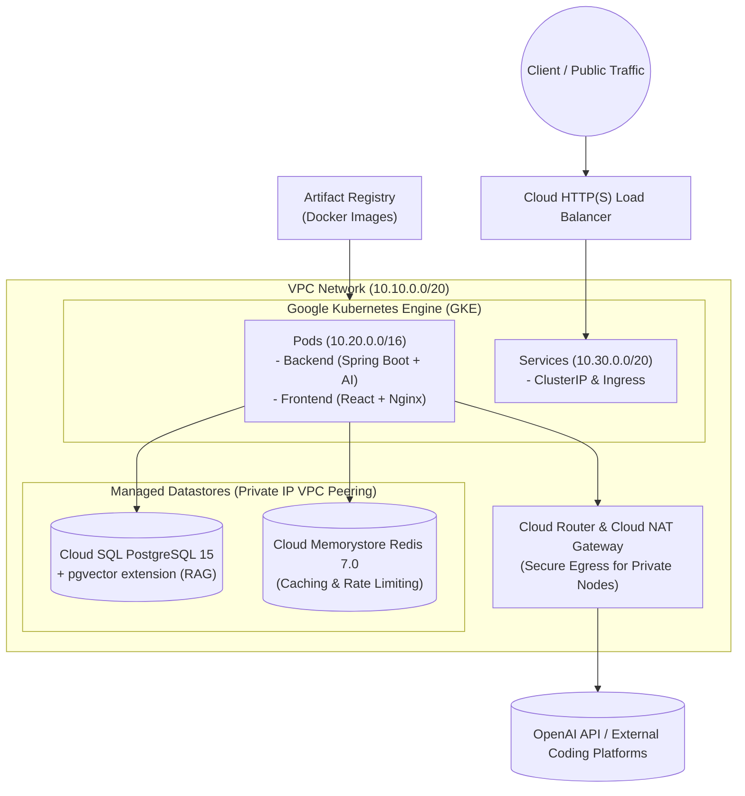

# CodeInsight AI - Infrastructure as Code (Terraform on GCP)

This directory contains the production-grade **Terraform Infrastructure as Code (IaC)** configuration used to provision and manage the cloud infrastructure for **CodeInsight AI** on Google Cloud Platform (GCP).

---

## 🏛️ Architecture Overview

The infrastructure provisions a fully isolated, secure, and auto-scaling cloud environment:



---

## 📦 Modular Components

| Module | Resource Types | Description |
| :--- | :--- | :--- |
| **`modules/vpc`** | `google_compute_network`, `google_compute_subnetwork`, `google_compute_router_nat` | Custom VPC with secondary IP ranges for GKE Pods & Services, Cloud NAT for private node egress, and Private Service Access peering. |
| **`modules/gke`** | `google_container_cluster`, `google_container_node_pool`, `google_service_account` | Private GKE cluster with VPC-native IP aliasing, Workload Identity, Calico network policy, and autoscaling node pools (1–4 nodes). |
| **`modules/cloud_sql`** | `google_sql_database_instance`, `google_sql_database`, `google_sql_user` | PostgreSQL 15 instance accessible via Private IP only, configured with `cloudsql.enable_pgvector = on` for AI RAG embeddings. |
| **`modules/redis`** | `google_redis_instance` | Cloud Memorystore Redis 7.0 instance for distributed caching and API rate limiting. |
| **`modules/artifact_registry`** | `google_artifact_registry_repository` | Private Docker repository for backend and frontend container image storage. |

---

## 🚀 Quickstart & Deployment Guide

### Prerequisites
1. **Google Cloud SDK (`gcloud`)** installed and authenticated:
   ```bash
   gcloud auth login
   gcloud auth application-default login
   gcloud config set project YOUR_GCP_PROJECT_ID
   ```
2. **Terraform CLI (>= 1.5.0)** installed.
3. Enable required GCP Service APIs:
   ```bash
   gcloud services enable \
     compute.googleapis.com \
     container.googleapis.com \
     servicenetworking.googleapis.com \
     sqladmin.googleapis.com \
     redis.googleapis.com \
     artifactregistry.googleapis.com
   ```

### 1. Configure Variables
Copy the sample configuration file and update values with your environment details:
```bash
cp terraform.tfvars.example terraform.tfvars
```

### 2. Initialize and Validate Terraform
```bash
terraform init
terraform validate
```

### 3. Review Plan
```bash
terraform plan -out=tfplan
```

### 4. Provision Infrastructure
```bash
terraform apply tfplan
```

### 5. Configure `kubectl` Access
After provisioning completes, connect to the GKE cluster using the output command:
```bash
$(terraform output -raw kubectl_configure_command)
kubectl get nodes
```

---

## 🔒 Security Best Practices Implemented
- **Private Nodes**: GKE worker nodes do not have public IP addresses; outbound access to APIs (OpenAI, GitHub, LeetCode) is routed securely through Cloud NAT.
- **Private DB Access**: Cloud SQL and Redis communicate over private VPC peering (`servicenetworking.googleapis.com`), preventing public exposure of database ports.
- **Least-Privilege Node IAM**: GKE nodes run under a dedicated service account restricted to log writing, metric reporting, and image pulling.
- **Workload Identity**: Workloads inside Kubernetes authenticate to GCP APIs without mounting sensitive static service account keys in pods.
